# vic-fut

Interactive design prototypes for a multi-team football fan app. One app, three design directions, three clubs (Real Madrid, FC Barcelona, Manchester United). Every prototype is navigable and switches club live.

**Live landing page:** https://juandozuna.github.io/vic-fut/

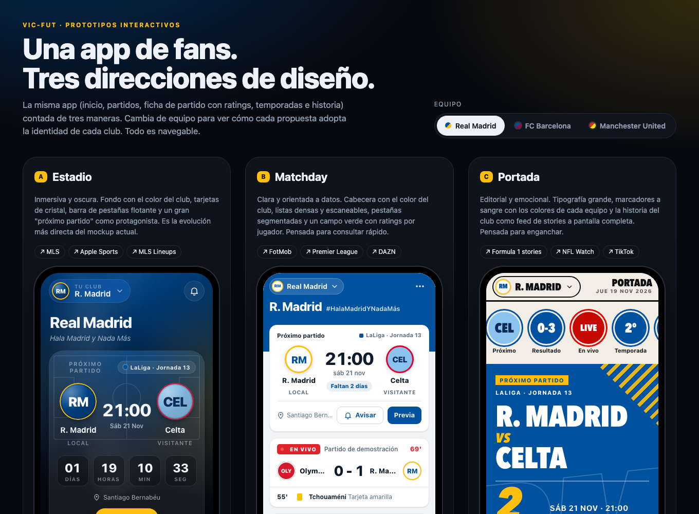

The landing page shows the three prototypes side by side in phone frames. One switcher at the top re-themes all three at once.

## The three options

Each option covers the same features as the original mockup:
- **Inicio:** next match and news.
- **Partidos:** fixtures and results.
- **Match detail:**
  - **Ratings:** 11 vs 11 on a pitch; tap a player for their stats and heatmap.
  - **Estadísticas:** match stats.
  - **Resumen:** event timeline.
- **En vivo:** a live demo match that advances by itself.
- **Temporadas:** season summary, results and squad.
- **Historia:** full-screen story feed of club history.
- **Más:** club info and settings.

### A · Estadio: immersive and dark

The closest evolution of the current mockup. A background gradient in the club's colours, frosted-glass cards, a floating tab bar and a large countdown to the next match.
Mobbin references: [MLS](https://mobbin.com/screens/3fcac024-96e4-49ba-b47d-82d772364bda), [Apple Sports](https://mobbin.com/screens/6e38370d-dd88-40f6-a066-6aa6cd4b0931), [MLS lineups](https://mobbin.com/screens/05e8dc71-e298-4662-9407-3ea3af6964b4).

[Open prototype A](https://juandozuna.github.io/vic-fut/prototypes/a-estadio/)

| Real Madrid · Inicio | FC Barcelona · Inicio | Man United · Inicio |
|---|---|---|
| 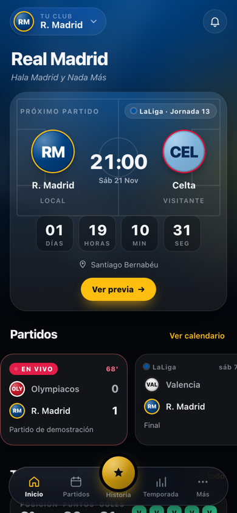 | 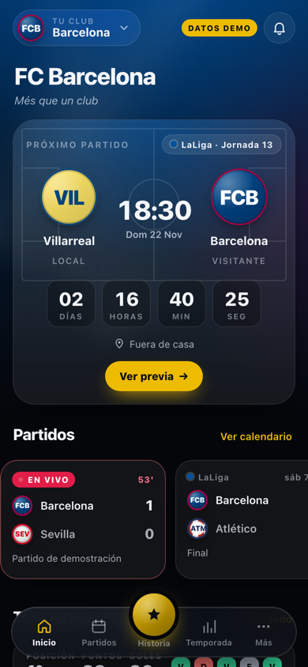 | 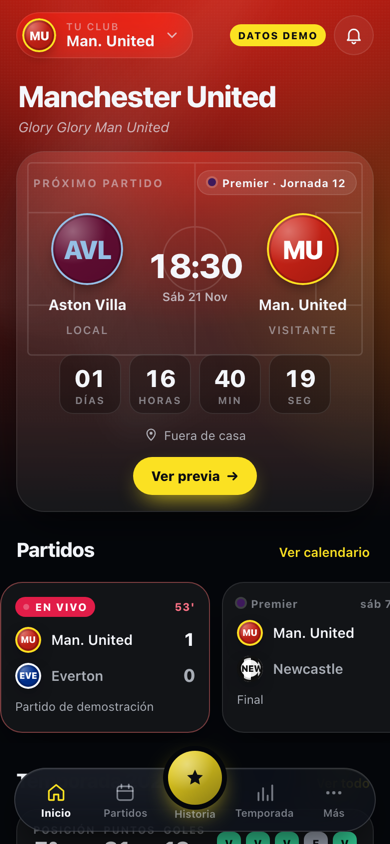 |
| **Real Madrid · Ratings** | **FC Barcelona · Ratings** | **Man United · Ratings** |
| 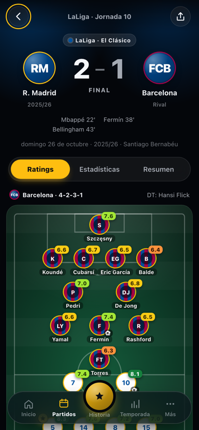 | 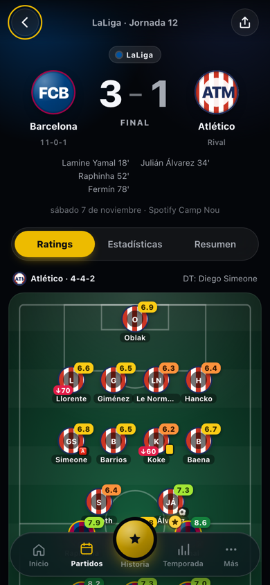 | 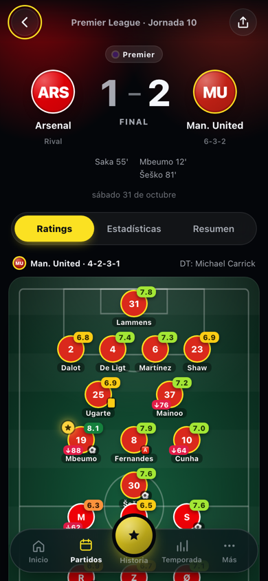 |
| **Real Madrid · Historia** | **FC Barcelona · Historia** | **Man United · Historia** |
| 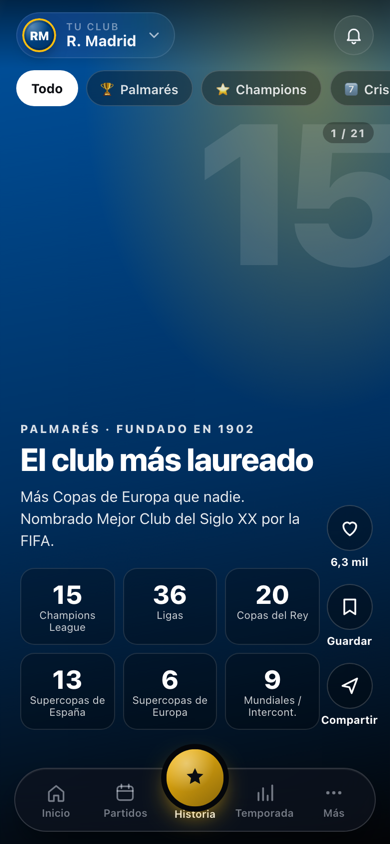 | 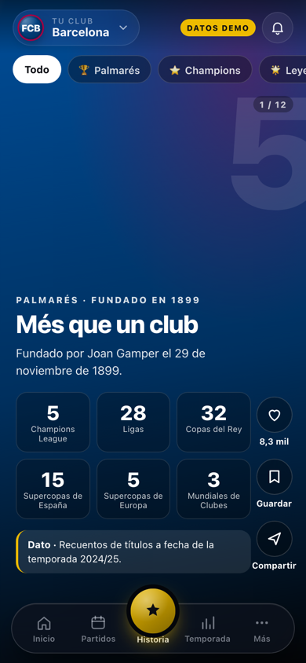 | 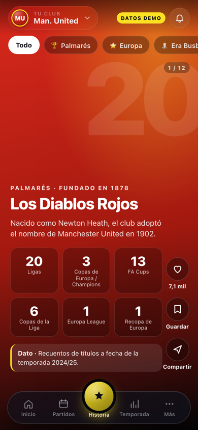 |

### B · Matchday: clean and data-dense

Light background, a header bar in the club's colour, white cards that are quick to scan, segmented tabs, a mini league table, and a green pitch with ratings coloured from red to green. Includes a working dark mode.
Mobbin references: [FotMob](https://mobbin.com/screens/ac4c1a37-b0aa-4099-9672-334e9def90df), [Premier League](https://mobbin.com/screens/7b028150-404e-4e1b-9a59-b68f0cc0810e), [DAZN](https://mobbin.com/screens/55588bc8-b85c-4dea-8748-c782cb0a6821).

[Open prototype B](https://juandozuna.github.io/vic-fut/prototypes/b-matchday/)

| Real Madrid · Inicio | FC Barcelona · Inicio | Man United · Inicio |
|---|---|---|
| 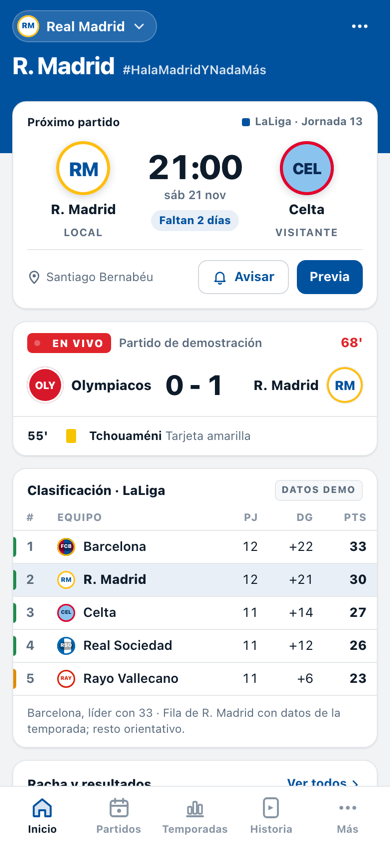 | 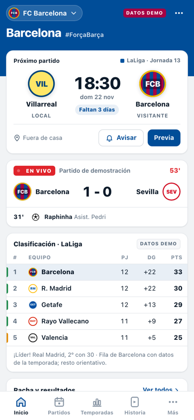 | 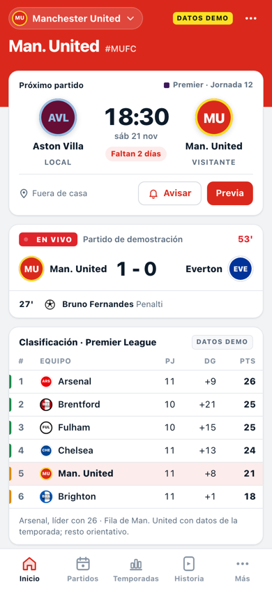 |
| **Real Madrid · Ratings** | **FC Barcelona · Ratings** | **Man United · Ratings** |
| 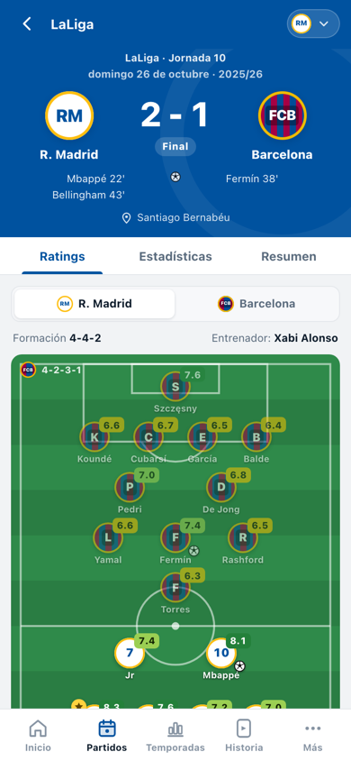 | 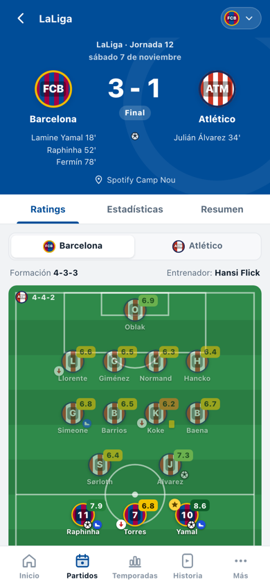 | 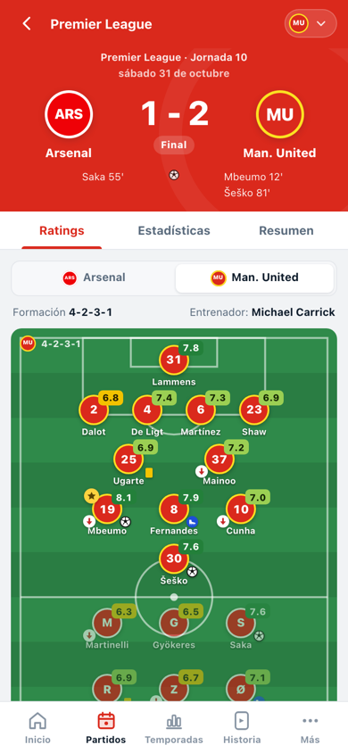 |
| **Real Madrid · Historia** | **FC Barcelona · Historia** | **Man United · Historia** |
| 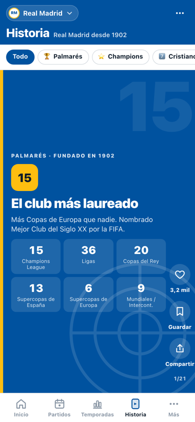 | 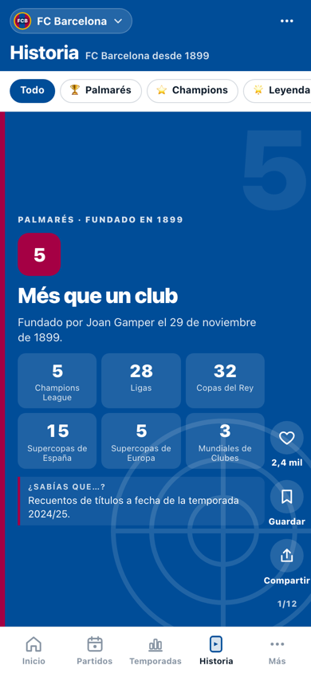 | 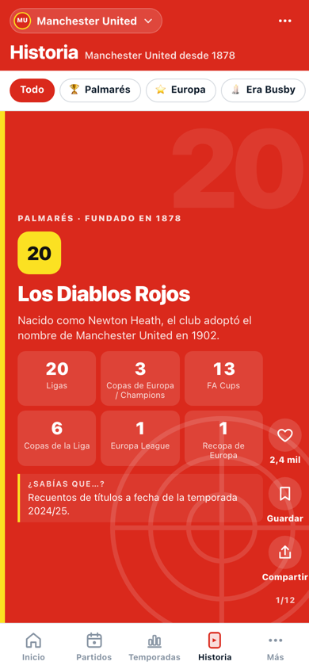 |

### C · Portada: editorial and bold

The club as a magazine cover:
- Large condensed type.
- A row of story rings with a full-screen story viewer (progress bars, tap through).
- Score cards split in each team's colours, with oversized numbers.
- A history feed with a like/save/share rail on the right.

Mobbin references: [Formula 1 stories](https://mobbin.com/screens/11a7bec2-741a-4700-8747-9915c1c0c4c4), [NFL Watch](https://mobbin.com/screens/923d1339-0a2a-46bf-8990-4c81a4810f3e), [TikTok](https://mobbin.com/screens/556e5bc3-e71f-4f0a-b7cf-712b443ffce8).

[Open prototype C](https://juandozuna.github.io/vic-fut/prototypes/c-portada/)

| Real Madrid · Inicio | FC Barcelona · Inicio | Man United · Inicio |
|---|---|---|
| 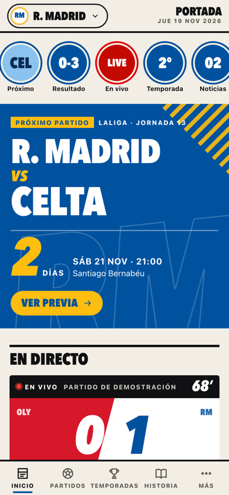 | 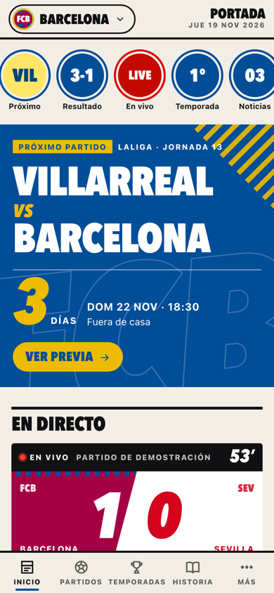 | 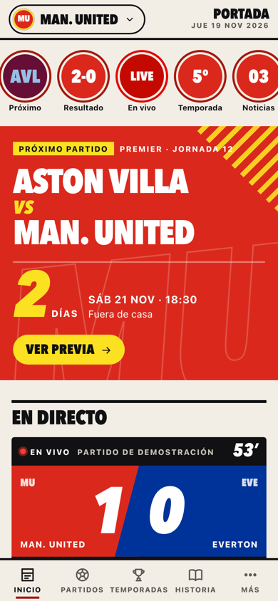 |
| **Real Madrid · Ratings** | **FC Barcelona · Ratings** | **Man United · Ratings** |
| 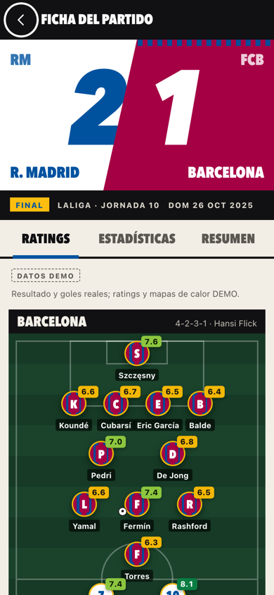 | 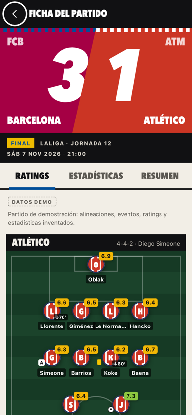 | 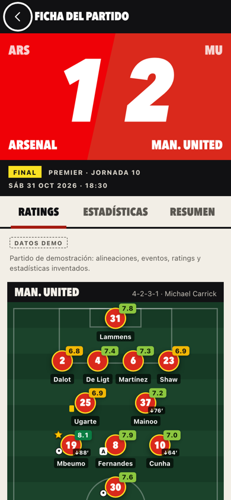 |
| **Real Madrid · Historia** | **FC Barcelona · Historia** | **Man United · Historia** |
| 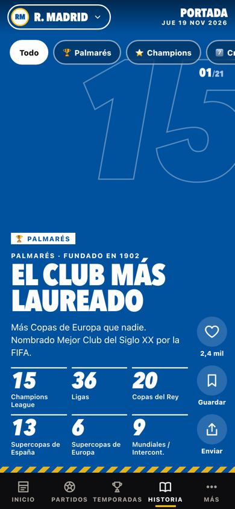 | 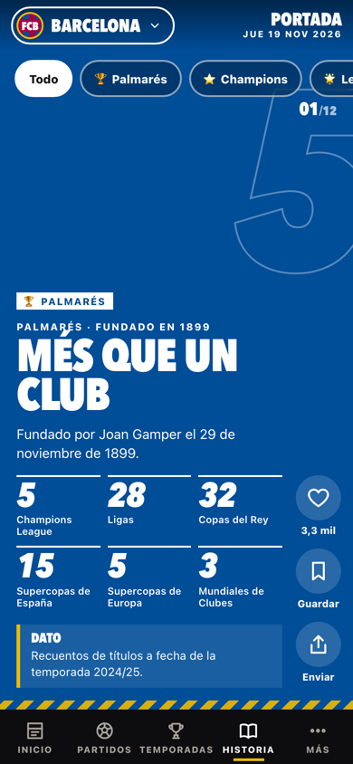 | 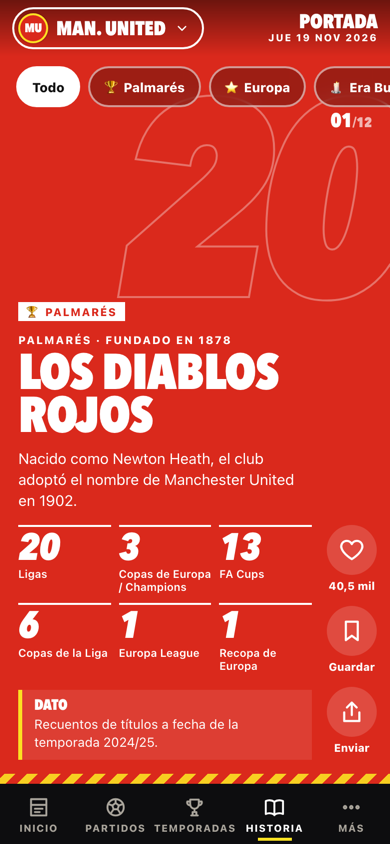 |

## Multi-team

All club content lives in [`shared/teams.js`](shared/teams.js) (schema: [`shared/README.md`](shared/README.md)). The prototypes contain no hard-coded team data. Each one:
- reads `VICFUT.order`, so **adding a club means adding one entry** to that file;
- re-themes from `team.colors` through CSS custom properties.

Ways to control a prototype:
- **Club picker:** the club pill in each prototype's header.
- **URL:** `?team=rm|fcb|mu` selects the club and `?screen=home|matches|match|season|history|more` opens a screen, e.g. `prototypes/b-matchday/?team=fcb&screen=match`.
- **Embedding:** `postMessage({type:'vicfut:team', team:'mu'})` switches the club; the landing page uses this.

## Run locally

No build step:

```sh
python3 -m http.server 8000
# open http://localhost:8000/
```

The prototypes also open directly from the file system.

## Data notes

- **Real Madrid:** data reused from the original mockup.
- **Barça and Man United:** the current season (2026/27) is **demo data** and is marked "DATOS DEMO" in the UI. Their history cards are real historical facts, and title counts are given as of 2024/25.
- **Coaches:** the 2026/27 coaches for Barça and United are unverified placeholders.
- **Ratings and heatmaps:** illustrative.
- **Kick-off times:** shown in Spanish time (`Europe/Madrid`).
- **No crests or logos:** clubs appear only as monograms and colours.

Unofficial fan app · design prototype.
